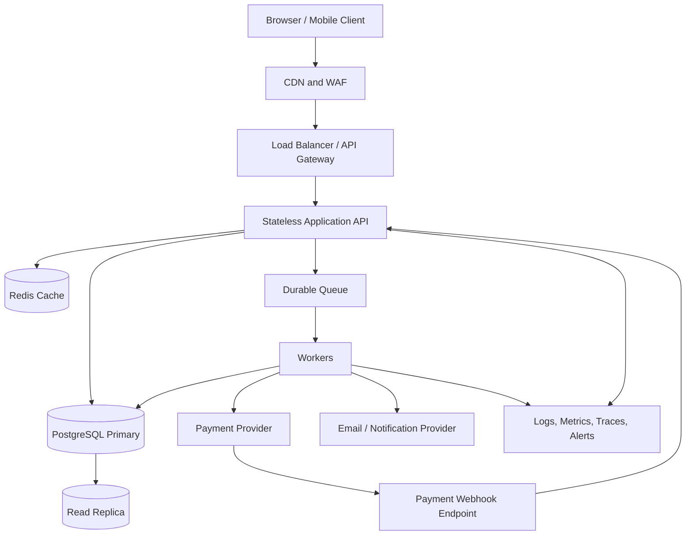

# TicketHub: Event Ticketing System Design

## 1. Requirements

### Functional requirements

1. Visitors can browse events and view event details, venue capacity, seat maps, prices, and remaining availability.
2. Registered users can sign in and purchase one or more available seats.
3. A user can temporarily hold selected seats while completing checkout. A hold expires automatically after a defined period (for example, five minutes).
4. A successful payment confirms the booking and issues unique tickets with scannable ticket identifiers.
5. Users can view their bookings and ticket status; authorized staff can validate tickets at the venue.
6. The system prevents two active bookings from owning the same seat, including during high-demand sales.
7. Payment callbacks, retries, and repeated client requests are handled idempotently so they cannot create duplicate bookings or charges.
8. Users receive booking confirmation and failure/expiry notifications.

### Non-functional requirements (testable targets)

- **Correctness:** never confirm two bookings for the same seat and event; enforce this in the primary database, not only in application code.
- **Availability:** target at least 99.9% monthly availability for browsing and 99.9% for purchase APIs, excluding announced maintenance.
- **Latency:** event detail and availability reads should meet p95 < 300 ms under normal load; checkout API responses should meet p95 < 500 ms excluding external payment-provider time.
- **Burst handling:** during a popular sale, accept 200,000 interested users over ten minutes (about 333 requests/second if evenly distributed), while explicitly testing much sharper bursts such as 10x that average.
- **Durability:** once a booking is confirmed, its order and ticket records must survive service restarts and normal infrastructure failures.
- **Security:** authenticate account actions, authorize booking access, validate inputs, rate-limit sensitive endpoints, and never store raw card details.
- **Observability:** track request rate, latency, error rate, queue depth, seat-hold expiry, payment reconciliation, and oversell-prevention conflicts; alert on sustained errors.
- **Recovery:** maintain tested database backups and a documented restore process with defined recovery-point and recovery-time objectives.

## 2. Estimates

Given:
- 2,000,000 registered users.
- 50,000 visitors on a normal day, each viewing 10 pages.
- 5,000 tickets sold on a normal day.
- For a popular concert, 200,000 people try to buy 20,000 seats in the first 10 minutes.

### Normal-day traffic

- Page views/day = 50,000 visitors × 10 pages = **500,000 page views/day**.
- Average page-view rate = 500,000 ÷ 86,400 seconds ≈ **5.8 page views/second**.
- If each page view causes 2 API reads on average, that is about 1,000,000 read requests/day, or **11.6 reads/second on average**. This is an assumption for capacity planning, not a measured fact.
- Tickets sold/day = **5,000**. If each ticket sale results in 4 write operations (hold/order/payment/ticket-related writes, simplified), that is about 20,000 writes/day, or **0.23 writes/second on average**. Actual write counts depend on the implementation.

Daily averages hide peaks. Capacity should be based on measured peak-to-average ratios and load tests, not averages alone.

### Popular-sale traffic

- Interested users per second = 200,000 ÷ 600 seconds ≈ **333 people/second** on average over the ten-minute window.
- Seats available = 20,000; demand = 200,000 people, or **10 interested people per seat**.
- If each person makes 3 API calls during discovery and checkout, that is roughly 600,000 calls / 600 seconds = **1,000 requests/second** on average during the sale.
- If traffic arrives in a short launch burst, a 10x planning multiplier would imply roughly **3,300 people/second** or **10,000 requests/second** for that assumed API mix. These are load-test targets, not guarantees.

The most sensitive resource is not page rendering; it is contention on the limited inventory. Protect the database with bounded concurrency, short transactions, queueing/admission control where needed, and cached read-only event information. Never promise a seat based only on a cached availability count.

## 3. API Design

Use versioned REST endpoints over HTTPS. Require authentication for holds, orders, and personal bookings. The client supplies an idempotency key for state-changing requests.

| Method and endpoint | Purpose | Important behavior |
|---|---|---|
| `GET /api/v1/events` | Browse/search events | Paginated; cacheable where appropriate |
| `GET /api/v1/events/{eventId}` | Event details and venue info | Read-only; may use cache |
| `GET /api/v1/events/{eventId}/availability` | Show current seat availability | Advisory only; final decision is transactional |
| `POST /api/v1/events/{eventId}/holds` | Hold one or more seats | Authenticated; idempotency key; fails cleanly if any requested seat is unavailable |
| `GET /api/v1/holds/{holdId}` | Inspect hold and expiry | Returns status and expiry timestamp |
| `DELETE /api/v1/holds/{holdId}` | Release an unpurchased hold | Idempotent; cannot release another user's hold |
| `POST /api/v1/orders` | Create an order from a valid hold | Validates ownership, expiry, and price snapshot |
| `POST /api/v1/orders/{orderId}/payment-intent` | Start payment with provider | Uses provider idempotency support where available |
| `POST /api/v1/webhooks/payments` | Receive payment result | Verifies signature; deduplicates provider event IDs |
| `GET /api/v1/me/bookings` | List the signed-in user's bookings | Enforces user-level authorization |
| `GET /api/v1/bookings/{bookingId}/tickets` | Retrieve issued tickets | Only booking owner or authorized staff |
| `POST /api/v1/tickets/{ticketId}/validate` | Scan/check a ticket at entry | Staff-only; atomic validation to prevent reuse |

### Example hold request

```http
POST /api/v1/events/evt_123/holds
Authorization: Bearer <access-token>
Idempotency-Key: 4f40b3d8-...
Content-Type: application/json

{
  "seatIds": ["A-12", "A-13"]
}
```

A successful response returns a hold ID, seat IDs, status, and `expiresAt`. If the seats cannot all be held, return a conflict (HTTP 409) and do not create a partial hold unless the API explicitly documents partial success. Return 401 for missing authentication, 403 for unauthorized access, 404 for unknown resources, 409 for inventory conflicts, 422 for invalid input, and 429 when rate-limited. Avoid leaking private information in errors.

## 4. Data Model

Use PostgreSQL as the authoritative store for inventory, holds, orders, and bookings. The schema below is illustrative; exact types and indexes should be validated against the chosen framework and query patterns.

### Core tables

1. **users**
   - `id UUID PRIMARY KEY`
   - `email CITEXT UNIQUE NOT NULL`
   - `created_at TIMESTAMPTZ NOT NULL`

2. **events**
   - `id UUID PRIMARY KEY`
   - `name TEXT NOT NULL`
   - `venue_id UUID NOT NULL`
   - `starts_at TIMESTAMPTZ NOT NULL`
   - `status TEXT NOT NULL`

3. **seats**
   - `id UUID PRIMARY KEY`
   - `venue_id UUID NOT NULL`
   - `section TEXT NOT NULL`
   - `row_label TEXT NOT NULL`
   - `seat_number TEXT NOT NULL`
   - `UNIQUE (venue_id, section, row_label, seat_number)`

4. **event_inventory**
   - `event_id UUID NOT NULL REFERENCES events(id)`
   - `seat_id UUID NOT NULL REFERENCES seats(id)`
   - `status TEXT NOT NULL CHECK (status IN ('available','held','sold'))`
   - `hold_id UUID NULL`
   - `hold_expires_at TIMESTAMPTZ NULL`
   - `booking_id UUID NULL`
   - `version BIGINT NOT NULL DEFAULT 0`
   - `PRIMARY KEY (event_id, seat_id)`

5. **holds**
   - `id UUID PRIMARY KEY`
   - `user_id UUID NOT NULL REFERENCES users(id)`
   - `event_id UUID NOT NULL REFERENCES events(id)`
   - `status TEXT NOT NULL CHECK (status IN ('active','converted','released','expired'))`
   - `expires_at TIMESTAMPTZ NOT NULL`
   - `idempotency_key TEXT NOT NULL`
   - `created_at TIMESTAMPTZ NOT NULL`
   - `UNIQUE (user_id, idempotency_key)`

6. **hold_items**
   - `hold_id UUID NOT NULL REFERENCES holds(id)`
   - `event_id UUID NOT NULL`
   - `seat_id UUID NOT NULL`
   - `PRIMARY KEY (hold_id, event_id, seat_id)`
   - `FOREIGN KEY (event_id, seat_id) REFERENCES event_inventory(event_id, seat_id)`

7. **orders**
   - `id UUID PRIMARY KEY`
   - `user_id UUID NOT NULL REFERENCES users(id)`
   - `hold_id UUID NOT NULL UNIQUE REFERENCES holds(id)`
   - `amount_minor BIGINT NOT NULL CHECK (amount_minor >= 0)`
   - `currency CHAR(3) NOT NULL`
   - `status TEXT NOT NULL`
   - `created_at TIMESTAMPTZ NOT NULL`

8. **payments**
   - `id UUID PRIMARY KEY`
   - `order_id UUID NOT NULL REFERENCES orders(id)`
   - `provider_payment_id TEXT UNIQUE`
   - `provider_event_id TEXT UNIQUE`
   - `status TEXT NOT NULL`
   - `amount_minor BIGINT NOT NULL`
   - `created_at TIMESTAMPTZ NOT NULL`

9. **bookings**
   - `id UUID PRIMARY KEY`
   - `order_id UUID NOT NULL UNIQUE REFERENCES orders(id)`
   - `user_id UUID NOT NULL REFERENCES users(id)`
   - `status TEXT NOT NULL`
   - `confirmed_at TIMESTAMPTZ NULL`

10. **tickets**
    - `id UUID PRIMARY KEY`
    - `booking_id UUID NOT NULL REFERENCES bookings(id)`
    - `event_id UUID NOT NULL`
    - `seat_id UUID NOT NULL`
    - `ticket_code_hash TEXT NOT NULL UNIQUE`
    - `status TEXT NOT NULL CHECK (status IN ('valid','used','cancelled'))`
    - `UNIQUE (event_id, seat_id)` — an additional final guard against issuing two tickets for the same event seat.

Useful indexes include `event_inventory(event_id, status)`, `event_inventory(hold_expires_at) WHERE status = 'held'`, `holds(status, expires_at)`, `orders(user_id, created_at DESC)`, and `payments(order_id)`. Foreign keys and unique constraints are correctness controls, not optional optimizations. In a production migration, ensure booking/order references are added in an order that avoids circular table creation issues.

## 5. Architecture

### Mermaid diagram



### ASCII diagram

```text
Users
  |
CDN / WAF
  |
Load Balancer / API Gateway
  |
Stateless API -------- Redis (cache only)
  |  \
  |   \---- Durable Queue ---- Workers ---- Payment Provider
  |                              |              |
  |                              +---- Notifications
  |                                             |
  +---------------- PostgreSQL Primary <--- Payment Webhooks
                          |
                     Read Replica
                          |
                 Monitoring / Alerts
```

### Component responsibilities and peak handling

- **Client:** displays event and seat information, but never decides whether a seat is truly available.
- **CDN/WAF:** caches public event images and static assets, absorbs common traffic, blocks abusive patterns, and applies edge rate limits. Authenticated or personalized responses must not be shared-cacheable.
- **Load balancer/API gateway:** routes requests, enforces request size/time limits, rate-limits clients, and can apply a waiting-room/admission token for high-demand events.
- **Stateless API servers:** validate requests and authorization, coordinate short database transactions, and scale horizontally. Keep session/state out of local process memory.
- **Redis cache:** stores event metadata and other safe read-heavy data with TTLs. Cached availability is informational only; Redis is not the source of truth for ownership of a seat.
- **PostgreSQL primary:** owns inventory state and all authoritative booking/payment/order records. Transactions and constraints prevent double booking. Use connection pooling, sensible indexes, and short transactions.
- **Durable queue and workers:** perform retryable asynchronous work such as notifications, payment follow-up, and reconciliation. Jobs need deduplication, bounded retries, dead-letter handling, and monitoring. Queue messages never replace the database's transactional decision.
- **Payment provider and webhook endpoint:** payment is external and can time out or send duplicate callbacks. Verify webhook signatures, record provider event IDs uniquely, and reconcile ambiguous results.
- **Read replica:** serves suitable non-critical reads such as browsing or booking history when replication lag is acceptable. Do not use a lagging replica to authorize seat sales.
- **Observability:** correlate request, order, hold, and provider IDs; alert on database saturation, lock waits, queue backlog, payment mismatches, and inventory conflicts.

At the start of a popular sale, the waiting room can release a controlled number of users per second so the database is not overwhelmed. Public event details should be cached; checkout concurrency should be bounded. If the primary database is unavailable, fail closed for seat holds and sales rather than accepting unverified reservations.

## 6. Trade-offs

1. **Strong consistency vs. maximum throughput.** PostgreSQL transactions and row-level locking add contention for a highly popular event, but they provide a clear authoritative decision and protect against overselling. Read-heavy pages can scale separately through caching and replicas.
2. **Temporary holds vs. direct purchase.** Holds reduce the chance that a user pays while someone else gets the seat, but they can temporarily lock inventory for abandoned checkouts. Short expirations and a reliable expiry worker reduce this cost; the booking transaction must also check expiry in case the worker is delayed.
3. **Synchronous vs. asynchronous processing.** Confirming inventory and order state must happen transactionally, while notifications and reconciliation can run asynchronously. This keeps checkout responsive, but introduces eventual consistency for non-critical side effects and requires retries and monitoring.
4. **Single primary vs. sharded inventory.** A single PostgreSQL primary is simpler to operate and sufficient to start with if tested and tuned. Very large global demand may eventually require partitioning by event or another inventory strategy, but distributing a single event's seats increases coordination complexity.

## Preventing Double Booking (Critical)

The database must make it impossible for two concurrent requests to successfully claim the same event seat. A prior availability read is not a lock: two requests can both observe a seat as available before either writes.

### Safe seat-hold transaction

For every requested seat, claim it conditionally inside a short transaction. For multi-seat requests, process seat IDs in a stable sorted order to reduce deadlocks. A simplified PostgreSQL pattern for one seat is:

```sql
BEGIN;

UPDATE event_inventory
SET status = 'held',
    hold_id = :hold_id,
    hold_expires_at = NOW() + INTERVAL '5 minutes',
    version = version + 1
WHERE event_id = :event_id
  AND seat_id = :seat_id
  AND (
    status = 'available'
    OR (status = 'held' AND hold_expires_at < NOW())
  )
RETURNING event_id, seat_id;

-- Application must verify exactly one row was returned.
-- If any requested seat was not claimed, ROLLBACK the entire
-- multi-seat hold and return HTTP 409 Conflict.
-- Insert hold and hold_items in the same transaction.

COMMIT;
```

Important details:

1. The conditional `UPDATE` is atomic. Concurrent updates to the same row serialize, and only the request satisfying the current predicate can claim it.
2. Check the affected-row count for **every** requested seat. If any seat is missing, roll back the entire multi-seat transaction so the user does not receive a partial hold by accident.
3. The primary key `(event_id, seat_id)` ensures one inventory row per seat per event. The unique `(event_id, seat_id)` on tickets is a second defensive constraint against duplicate ticket issuance.
4. A hold-expiry worker can periodically release expired holds, but the conditional claim path must also treat an expired hold as reclaimable. Correctness must not depend on a scheduled worker running on time.
5. Use database transactions for order creation and inventory state transitions. Avoid making network calls to a payment provider while holding database row locks.

### Payment, confirmation, and idempotency

- Require an idempotency key for hold/order creation and persist it under a unique constraint scoped to the user or operation. A retry returns the original result instead of creating a second hold or order.
- Keep payment state transitions explicit, for example `pending → succeeded` or `pending → failed`. Enforce uniqueness for the payment provider's payment ID and webhook event ID.
- After payment success is verified, use a database transaction to confirm the order/booking, mark the held inventory as sold, and create tickets. Verify that the hold still belongs to the order and that each seat is still held by that hold. If the hold expired or the state no longer matches, do not silently issue tickets: enter a defined recovery/refund path.
- Webhooks may be delivered more than once or out of order. Deduplicate them using the provider event ID, check the provider payment/order identity and amount/currency, and make transitions safe to repeat.
- A reconciliation job compares local pending/failed states with the provider's authoritative payment status and repairs ambiguous outcomes. If payment succeeded but the inventory can no longer be fulfilled, flag it for immediate refund/manual recovery rather than overselling.
- Never treat a browser redirect or client-side “payment successful” message as proof of payment. Verify signed provider webhooks or query the provider server-to-server.
- Ticket codes should be unpredictable and stored as hashes where practical. Ticket validation should atomically change `valid` to `used` so a screenshot or repeated scan cannot redeem the same ticket twice.

### Race-condition test plan

1. Seed one available seat for an event.
2. Launch 100 concurrent hold requests for that same seat with distinct users and idempotency keys.
3. Assert that exactly one request succeeds, all others receive a conflict, and exactly one active hold exists.
4. Repeat with multi-seat holds where requests overlap on one seat; assert there are no partial holds and no duplicate tickets.
5. Test expired holds, delayed expiry workers, duplicate payment webhooks, client retries, database transaction rollback, and payment success arriving after hold expiry.
6. Run the same tests under load while monitoring lock waits, database connections, API latency, and queue depth.

**Invariant:** for a given `(event_id, seat_id)`, at most one active hold or one confirmed ticket may own the seat at a time. Enforce that invariant in the transactional database path, not just with application-level checks.
